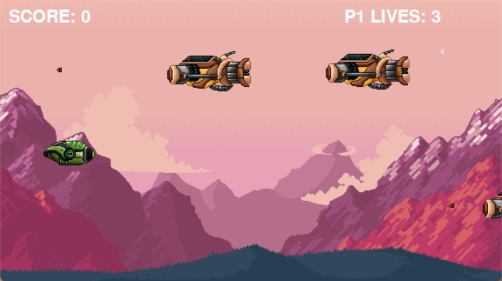

# Mountain Shooter

Jogo 2D desenvolvido em Python com a biblioteca Pygame, utilizando programacao orientada a objetos.

O projeto apresenta um jogo de tiro com movimentacao lateral, dois jogadores, inimigos, efeitos visuais, pontuacao e progressao entre fases.

## Captura de tela



## Tecnologias

- Python 3
- Pygame 2.6.1
- Programacao Orientada a Objetos (POO)
- SQLite3 e JSON
- Design Pattern Proxy
- Git e GitHub
- Visual Studio Code

## Funcionalidades

- Menu principal interativo
- Modos de um ou dois jogadores
- Duas fases com cenarios diferentes
- Dificuldade progressiva
- Disparos dos jogadores e dos inimigos
- Sistema de colisao
- Pontuacao por inimigos eliminados
- Tres vidas individuais por jogador
- Protecao temporaria apos receber dano
- Efeito visual de invulnerabilidade
- Tela de Game Over
- Tela de vitoria YOU WIN!
- Musicas especificas para menu e fases
- Controles visiveis no menu principal
- Ranking TOP 5 com nome do jogador
- Persistencia de pontuacoes com SQLite3 e JSON
- Validacao pelo padrao Proxy
- Tela de SCORE com imagem e musica

## Objetivo e condicoes de jogo

O objetivo e eliminar inimigos, evitar seus disparos
e acumular pontos para superar as duas fases.

- **Fase 1:** 100 pontos para avancar.
- **Fase 2:** 200 pontos acumulados para vencer.
- **Vitoria:** tela YOU WIN!.
- **Derrota:** tela GAME OVER quando todos os
  jogadores perdem suas vidas.

Cada jogador possui tres vidas e invulnerabilidade
temporaria apos receber dano.

## Controles

| Acao | Jogador 1 | Jogador 2 |
|------|-----------|-----------|
| Mover para cima | W | Seta para cima |
| Mover para baixo | S | Seta para baixo |
| Mover para esquerda | A | Seta para esquerda |
| Mover para direita | D | Seta para direita |
| Atirar | Espaco | Ctrl direito |

**Menu:** setas para selecionar e Enter para confirmar.

**Durante o jogo:** ESC retorna ao menu.

## Sistema de pontuacao

Ao terminar a partida, o jogador pode digitar seu
nome ou o nome da dupla, com ate 16 caracteres.

- ENTER: salvar a pontuacao.
- ENTER ou ESC: voltar ao menu depois de salvar.
- TOP 5: exibe as melhores pontuacoes.

Os resultados sao armazenados localmente em:

- `score_data/scores.sqlite3`: banco SQLite3.
- `score_data/scores.json`: registros em JSON.

A pasta `score_data/` e ignorada pelo Git para
proteger as pontuacoes pessoais.

### Design Pattern Proxy

O sistema utiliza a arquitetura:

`Score -> ScoreProxy -> ScoreStorage`

- **Score:** tela, nome do jogador e ranking.
- **ScoreProxy:** valida os dados e intermedeia o acesso.
- **ScoreStorage:** salva os dados no SQLite3,
  exporta o JSON e consulta as pontuacoes.

## Como executar

### 1. Clonar o repositorio

```bash
git clone https://github.com/eckstein75/mountainShooter.git
cd mountainShooter
```

### 2. Criar o ambiente virtual

No Windows:

```powershell
python -m venv venv
```

### 3. Ativar o ambiente virtual

No PowerShell:

```powershell
.\venv\Scripts\Activate.ps1
```

Caso a politica de execucao bloqueie a ativacao, utilize o interpretador diretamente:

```powershell
.\venv\Scripts\python.exe -m pip install -r requirements.txt
.\venv\Scripts\python.exe main.py
```

### 4. Instalar as dependencias

Com o ambiente virtual ativado:

```powershell
python -m pip install -r requirements.txt
```

### 5. Iniciar o jogo

```powershell
python main.py
```

## Executavel para Windows

O jogo foi compilado utilizando PyInstaller.

A distribuicao da atividade academica inclui
o executavel `MountainShooter.exe`, as bibliotecas
necessarias e os assets do jogo.

Para utilizar a versao compilada:

1. Extraia o arquivo ZIP.
2. Abra a pasta `MountainShooter`.
3. Execute `MountainShooter.exe`.

O repositorio GitHub disponibiliza o codigo-fonte.
O pacote Windows foi preparado separadamente.

## Organizacao do projeto

```text
mountainShooter/
|-- asset/
|-- code/
|   |-- __init__.py
|   |-- Background.py
|   |-- Enemy.py
|   |-- Entity.py
|   |-- EntityFactory.py
|   |-- Game.py
|   |-- Level.py
|   |-- Menu.py
|   |-- Player.py
|   |-- Score.py
|   |-- ScoreProxy.py
|   `-- ScoreStorage.py
|-- main.py
|-- requirements.txt
|-- .gitignore
`-- README.md
```

## Arquitetura

O projeto utiliza classes para separar as responsabilidades:

- **Entity:** classe-base das entidades.
- **Background:** movimentacao dos cenarios.
- **Player:** movimentacao, disparos e vidas.
- **Enemy:** comportamento dos inimigos.
- **EntityFactory:** criacao das entidades.
- **Menu:** interface inicial.
- **Level:** fases, colisoes e pontuacao.
- **Game:** inicializacao e fluxo principal do jogo.
- **Score:** interface da pontuacao.
- **ScoreProxy:** validacao e intermediacao.
- **ScoreStorage:** armazenamento SQLite3 e JSON.

## Desenvolvimento

Projeto desenvolvido para praticar Python, Pygame, orientacao a objetos, modularizacao e controle de versao.

## Autor

**eckstein75**

GitHub: https://github.com/eckstein75

Repositorio: https://github.com/eckstein75/mountainShooter